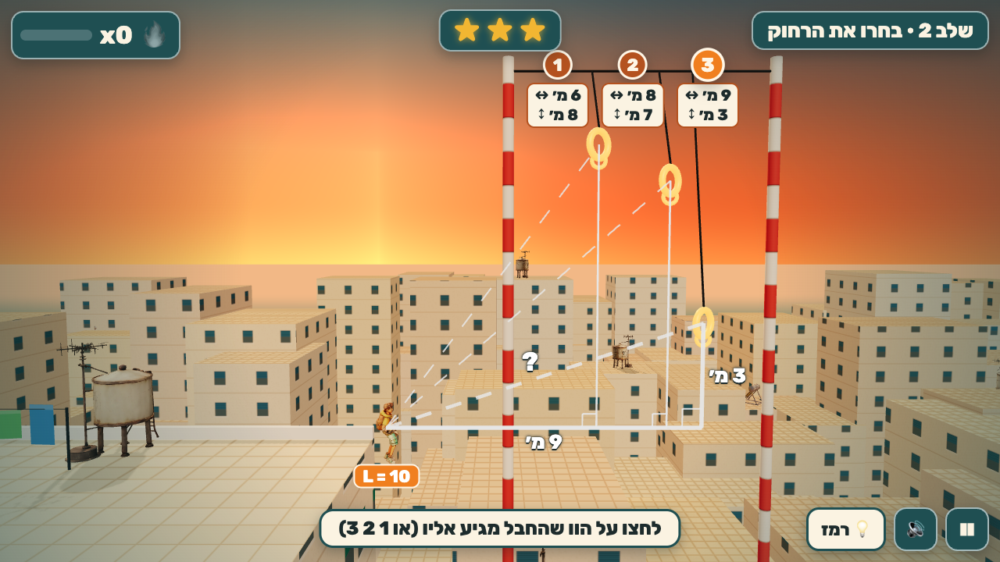

# קו היתר · Rooftop Hypotenuse

A one-tap **side-view swing runner** over sunset Tel Aviv rooftops for Hebrew-speaking grade-8 students
(Israeli curriculum, Workbook chapter 9: משפט פיתגורס).

The runner sprints on their own. At every gap time freezes mid-leap and 2–3 grapple hooks light up. Each
shows only its legs (↔ across, ↕ up or down), never the straight distance, and the rope has a fixed length
**L**. Tap the hook you think the rope reaches:

- **Right** (`a² + b² ≤ L²`): the rope snaps taut, a big pendulum swing, combo +1, more speed. The farthest hook that still reaches gives ⭐.
- **Wrong**: the rope stops short ("חסר 0.66 מ׳"), you bounce off a striped awning back to the same moment, that hook greys out, and a card shows `4² + 4² = 32 > 25`.

Thinking is never timed: the world waits while you decide. Stars: ⭐⭐⭐ no misses and every ⭐ line,
⭐⭐ no misses, ⭐ finished.

Eight levels: hypotenuse → the farthest legal hook → **jump strip** (find the leg: tap "jump" on the
right numbered tile) → **mid-air chains** of Pythagorean triples → hooks **below** you → a **courtyard**
in 3D (x, z, y) → **sign brackets** (converse: only right angles hold) → a **night transfer** level with
no numbers (count the bulbs, one per metre).



## Run

```bash
npm install
npm run dev      # http://localhost:5178
npm test         # rules, level numbers, full simulated play-through of every level (best and wrong-first)
npm run build    # static build in dist/ (relative base, works offline)
npm run shots    # headless Chromium screenshots into screenshots/ (dev server running)
```

## Controls

| | Desktop | Touch |
|---|---|---|
| Pick a hook (when time freezes) | Click it, or keys 1 / 2 / 3 (hover shows its triangle) | Tap it |
| Jump strip | Space (or the קפיצה! button) | קפיצה! |
| Let go early mid-swing (a flip) | Space / click | Tap |
| Hint (fills `a² + b² = ?`) | H or 💡 | 💡 |
| Pause / restart / mute | Esc or P / R / M | Buttons |

`?touch=1` forces the touch layout on desktop.

## Code map

- `src/rules.ts`: pure reach math (squared comparisons, find-a-leg, converse).
- `src/levels.ts`: the 8 level specs and `buildCourse` (decision points, hooks, catch canopies, landing roofs placed so every legal swing clears every roof).
- `src/sim.ts`: deterministic state machine (run → leap → decide → rope → swing/pull → fly → land; miss → canopy → bounce back; climb; strip). Pendulum with an inextensible rope and reel-in.
- `src/autoplay.ts`: scripted players (best, wrong-first) for tests and the browser hook.
- `src/world.ts`, `src/textures.ts`: the 3D scene. `src/hero.ts`: the Tripo-rigged runner. `src/overlay.ts`: in-world triangle and labels. `src/main.ts`: camera, input, HUD, screens, sound, test hooks.
- `design/mockups/`: the ChatGPT gameplay mockups (v1 and v2) the UI was built against. `design/REDESIGN.md`: why v1 was replaced.

Test hooks: `window.render_game_to_text()` (level, player state, L, the current decision with every hook's
a, b, z, reach, reaches, holds, ok, perfect, tried; combo, stars, misses, last outcome with `short_by_m`,
assets) and a deterministic `window.advanceTime(ms)`.

See `progress.md`, `PLAYTEST.md`, `CURRICULUM.md`, `ASSETS.md`.
